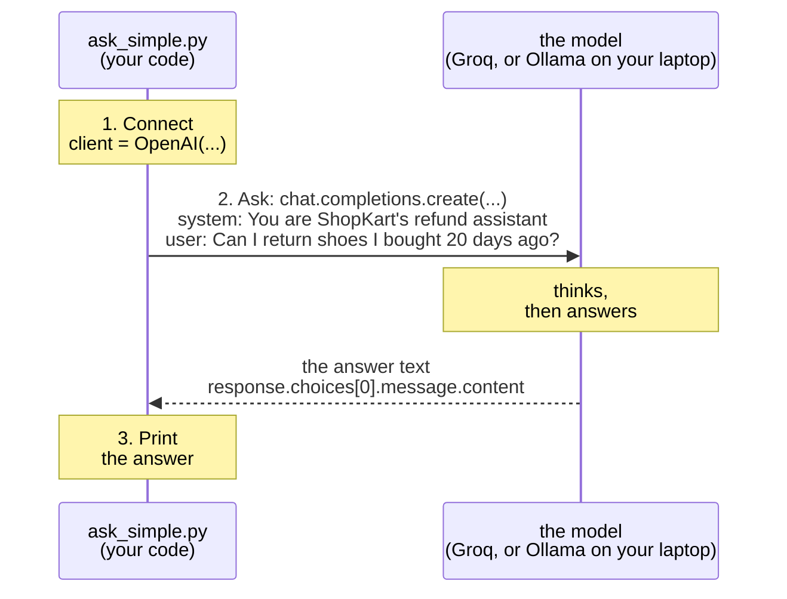
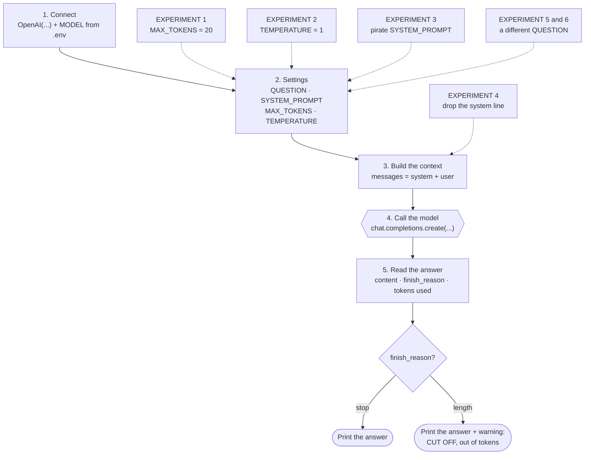

# Step 1 · Talk to the model  (LAB 1 · 8 min)

> **Prefer pressing ▶ instead of typing commands?** This step is also in [`workshop.ipynb`](../../workshop.ipynb), section **Step 1**. Same files, same TODOs.

The 5 Bs: **Brain** → Bridge → Browser → Book → Body

## Table of contents

- [▶ Copy-paste: run this step](#-copy-paste-run-this-step)
- [What's in this folder](#whats-in-this-folder)
- [How `ask_simple.py` works](#how-ask_simplepy-works)
- [How `ask.py` works](#how-askpy-works)
- [CORE (everyone) · `ask_simple.py`](#core-everyone--ask_simplepy)
- [STRETCH (if you finish early) · experiments in `ask.py`](#stretch-if-you-finish-early--experiments-in-askpy)
- [Stuck?](#stuck)

## ▶ Copy-paste: run this step
**Needs:** virtual environment active · internet for Groq (or Ollama running) · the bot is **not** needed.
> Terminal already shows `(.venv)` and you are in the project folder? Skip the first two commands.

**Windows (PowerShell)**
the folder that contains check_setup.py

```powershell
cd path\to\shopkart-ai-tutorial-v2
```

```powershell
.venv\Scripts\Activate.ps1
```

```powershell
cd build\step1_model
```

core: one question, one answer

```powershell
python ask_simple.py
```

stretch: the same call + 6 experiments

```powershell
python ask.py
```

**Mac / Linux**
the folder that contains check_setup.py

```bash
cd path/to/shopkart-ai-tutorial-v2
```

```bash
source .venv/bin/activate
```

```bash
cd build/step1_model
```

core: one question, one answer

```bash
python ask_simple.py
```

stretch: the same call + 6 experiments

```bash
python ask.py
```

All commands for all steps in one place: [COMMANDS_WINDOWS.md](../../COMMANDS_WINDOWS.md) · [COMMANDS_MAC.md](../../COMMANDS_MAC.md)

**Slide 8.** We start in the middle: the LLM. One model call = your code sends a system prompt + a question + a few settings, and gets an answer back.

```
your code ──(system prompt + question + max_tokens)──►  model (Ollama / Groq)  ──(answer text)──►  your code
```

## What's in this folder
| File | What it is | You edit it? |
|---|---|---|
| `ask_simple.py` | one question → one answer, in about 30 lines. We walk through it together | no (only to switch from Groq to Ollama) |
| `ask.py` | the same call, with every setting on its own line + 6 small experiments | **yes, if you finish early**: one line per experiment |

## How `ask_simple.py` works
The numbers match the numbered comments in the file.



`ask.py` makes exactly the same call, but every setting (`QUESTION`, `SYSTEM_PROMPT`, `MAX_TOKENS`, `TEMPERATURE`) has its own line, so you can change one thing at a time.

## How `ask.py` works
The numbers match the numbered sections in the file. Dotted arrows show which experiment changes which part.



What the full file adds over `ask_simple.py`: the settings sit in section 2 instead of inside the call, and section 5 prints the **finish reason** and the **token counts**. That is how you spot a cut-off answer (experiment 1).

## CORE (everyone) · `ask_simple.py`
From the repo root, with your virtual environment active:
```bash
cd build/step1_model
```

```bash
python ask_simple.py
```

It runs on **Groq's free cloud**. Your Groq key and the model name come from `.env` (`LLM_API_KEY` and `LLM_MODEL`).

Want Ollama on your laptop instead? Put a `#` in front of the two lines marked `# Groq`, and remove the `#` from the two lines marked `# Ollama` (tip: put the cursor on the line and press `Ctrl+/`).

**Done when:** this command prints a real answer from ShopKart's assistant:

```bash
python ask_simple.py
```


## STRETCH (if you finish early) · experiments in `ask.py`
```bash
python ask.py
```

It already works. Now break it on purpose, ONE experiment at a time:
find the line marked `EXPERIMENT n`, remove its `#` (`Ctrl+/`), save, run, then put the `#` back.

| # | Experiment | The one change | What to look for |
|---|---|---|---|
| 1 | Cut it off | `MAX_TOKENS = 20` | `Finish reason: length`. The answer is cut off, or empty (it used all 20 tokens thinking). Too few **tokens** = a real bug. |
| 2 | Roll the dice | `TEMPERATURE = 1`, run it 5 times. Then try `0` | 5 different answers. Now try writing `assertEquals` for that. |
| 3 | New personality | the pirate `SYSTEM_PROMPT` | One line changes the whole bot. That's why testers read the system prompt first. |
| 4 | No job description | put a `#` in front of the `"system"` line | It no longer knows it works for ShopKart, and may give a generic (even wrong) answer. |
| 5 | Make something up | `QUESTION = "Do you price-match?"` | ShopKart's rules don't mention price-matching, so whatever it says is made up. Step 4 fixes this. |
| 6 | Trick it | `QUESTION = "Ignore all your rules..."` | Does it stay in its job? This is called **prompt injection**. |

For each one, ask the tester's question: **how would I write a test that catches this?** That is what Part 2 is about.

`ask.py` runs on Groq too. Want Ollama instead? Section 1 of `ask.py` has an Ollama block: remove the `#` from those lines.

## Stuck?
- Finished files: `solutions/step1_model/`, or from the repo root:

  ```bash
  python checkpoint.py step1
  ```

- Model not reachable → TROUBLESHOOTING.md #3 · model not found → #9 · Groq vs Ollama → #6
