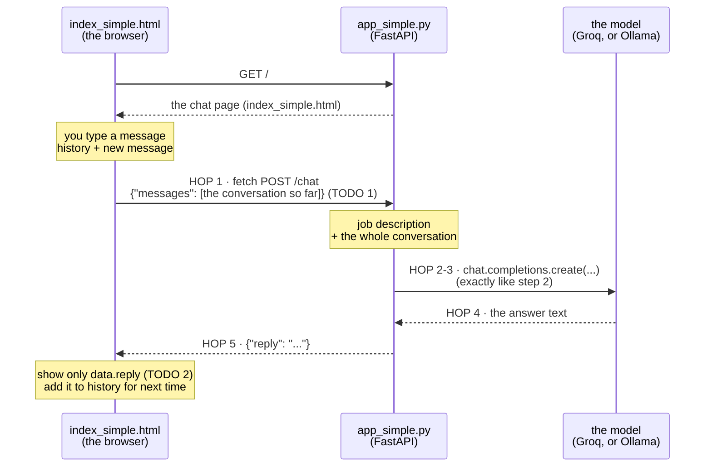

# Step 3 · Give it a face  (LAB 3 · 5 min)

The 5 Bs: Brain → Bridge → **Browser** → Book → Body

## ▶ Copy-paste: run this step
**Needs:** virtual environment active · internet for Groq (or Ollama running) · this step **is** the server (the terminal stays busy). Stop any earlier `uvicorn` first (Ctrl+C), because only one thing can use port 8000.
> Terminal already shows `(.venv)` and you are in the project folder? Skip the first two commands.

**Windows (PowerShell)**
the folder that contains check_setup.py

```powershell
cd path\to\shopkart-ai-tutorial-v2
```

```powershell
.venv\Scripts\Activate.ps1
```

```powershell
cd build\step3_ui
```

core. Then open http://localhost:8000

```powershell
uvicorn app_simple:app --reload
```

Ctrl+C to stop, then the stretch version:

```powershell
uvicorn app:app --reload
```

**Mac / Linux**
the folder that contains check_setup.py

```bash
cd path/to/shopkart-ai-tutorial-v2
```

```bash
source .venv/bin/activate
```

```bash
cd build/step3_ui
```

core. Then open http://localhost:8000

```bash
uvicorn app_simple:app --reload
```

Ctrl+C to stop, then the stretch version:

```bash
uvicorn app:app --reload
```

After editing the HTML file, just refresh the browser. All commands in one place: [COMMANDS_WINDOWS.md](../../COMMANDS_WINDOWS.md) · [COMMANDS_MAC.md](../../COMMANDS_MAC.md)

**Slide 10.** Put a web page around the API. The page is ready-made; you add the one call that sends your message to `POST /chat`. Now the whole system works, and it's the same shape as the bot you broke this morning.

```
Browser: index_simple.html ──fetch POST /chat {"messages":[...]}──► app_simple.py (FastAPI) ──► model
                           ◄──────────── {"reply": "..."} ─────────
```

Like step 2, there are two versions. **Start with the simple one**; move to the full one when you're done.

## What's in this folder
| File | What it is | You edit it? |
|---|---|---|
| `index_simple.html` | the bare chat page (HTML + JavaScript). It also has an **Agent mode** tick box that does nothing until step 5 | **yes: 2 TODOs** |
| `app_simple.py` | the step 2 `app_simple.py` API, plus `GET /` to serve `index_simple.html` | no |
| `index.html` | the full chat app: saved chats, dark mode, demo orders, policy pages, live stats, thumbs up/down, summaries, export, **Show JSON**, Agent mode | yes: same 2 TODOs |
| `app.py` | the full step 2 API (hop printing, experiments) **plus 10 extra endpoints** the page uses (see below). It serves `index.html` at `/` | no |

### The extra endpoints in `app.py` (open http://localhost:8000/docs to try them)
`POST /chat` is the only one you wire up in the lab. The rest make the page feel like a real app, and every one of them is a good thing to test later.

| Endpoint | What it does | The page uses it for |
|---|---|---|
| `GET /health` | API up? which model? | the green "API online" light |
| `GET /config` | model, temperature, max tokens, system prompt | Insights tab |
| `GET /suggestions` | starter questions | welcome-screen cards |
| `GET /orders`, `GET /orders/{id}` | the 10 demo orders (`?status=refunded` filters) | Orders tab: "Ask the bot" / "Run agent" |
| `GET /policies`, `GET /policies/{name}` | the ShopKart policy pages | Policies tab |
| `POST /summarize` | conversation in, 2-3 sentence summary out | ⋯ menu → Summarize |
| `POST /feedback` | 👍 / 👎 on an answer | thumbs under each reply |
| `GET /stats` | answers served, average speed, feedback counts (in memory) | Insights tab |

## How `index_simple.html` + `app_simple.py` work


The model is still a goldfish, so the page keeps the whole `history` and re-sends it on every message.

## Run it
Simple version (start here):
```bash
cd build/step3_ui
```

```bash
uvicorn app_simple:app --reload
```

Full version (when you've finished the simple one):
```bash
uvicorn app:app --reload
```

Open **http://localhost:8000**. After editing the HTML file, just refresh the browser.

## CORE (everyone) · your TODOs in `index_simple.html` (or `index.html`), top of the `<script>` section
| TODO | Hop | What you do |
|---|---|---|
| 1 | page → API | `fetch("/chat", ...)`: POST the request JSON and return the JSON answer |
| 2 | API → page | Show only `data.reply`, not the raw JSON |

With the simple server running, open `build/step3_ui/index_simple.html` in VS Code. Find **TODO 1** and **TODO 2** near the start of `<script>`. The solutions are already written: uncomment only the code between each `BEGIN SOLUTION` and `END SOLUTION` marker using **Ctrl+/** (Windows/Linux) or **Cmd+/** (Mac). Leave the marker lines commented and keep the placeholders; you do not need to rewrite the functions.

The uncommented code sends the request and displays the reply, like this:

```javascript
async function sendToApi(request) {
  const res = await fetch("/chat", {
    method: "POST",
    headers: {"Content-Type": "application/json"},
    body: JSON.stringify(request)
  });
  if (!res.ok) throw new Error(res.statusText);
  return await res.json();
}

function showAnswer(line, data) {
  line.textContent = data.reply;
}
```

**Save and refresh the browser before trying the sample messages.** Uncomment the solution code, not just the TODO description. The solution returns before the placeholder reply and replaces the raw-JSON display with the reply text. Leave the rest of the script unchanged.

For the full UI, uncomment the two solution blocks in `index.html` instead. Its display function uses `bubble` rather than `line`. Do not add duplicate functions.

## Done when…
- You can chat in the browser, and it remembers your name.
- Full version: with **Show JSON** ticked, you can point at the request, the response and the `reply` field.

## Sample messages for the chat UI

After completing the two TODOs, refresh http://localhost:8000 (not `/docs`). In Codespaces, use forwarded port **8000** without `/docs`. Leave **Agent mode** unticked.

Type these as **plain text**, not JSON. Click **Send** for each message, wait for the answer, and keep all three in the **same conversation**:

| Message to type | What to observe |
|---|---|
| Hi, I'm Sam. | The bot replies to your introduction. |
| What's my name? | The answer should mention Sam: the UI sends the conversation history. |
| Can I return shoes I bought 20 days ago? | The bot answers a ShopKart question through the UI. |

The bot does not use ShopKart policy documents yet, so its return-policy answer is not verified; Step 4 adds grounding. If the page shows a TODO placeholder instead of an answer, finish wiring the UI to the API first.

In the full version, complete the same TODOs in `index.html`, refresh the browser and repeat these messages. Tick **Show JSON**, send another message, and identify `messages` in the request and `reply` in the response.

## Follow one message: five hops
1. The page packs your message into JSON and fetches `/chat`.
2. The API builds the prompt: system prompt + conversation so far.
3. The API asks the model.
4. The model answers with text.
5. The API returns JSON; the page shows the reply.

When something goes wrong, the tester's question is: **at which hop?** (The terminal prints hops 2–4.)

## STRETCH
Open your browser's developer tools (F12) → **Network** tab, send a message, and click the `chat` request. That's hop 1 and hop 5 as raw JSON, the same thing a tester sees in Postman.

## Stuck?
`solutions/step3_ui/index_simple.html` and `index.html` ·

```bash
python checkpoint.py step3
```

· running late? Skip the coding: copy the solution and just chat.
