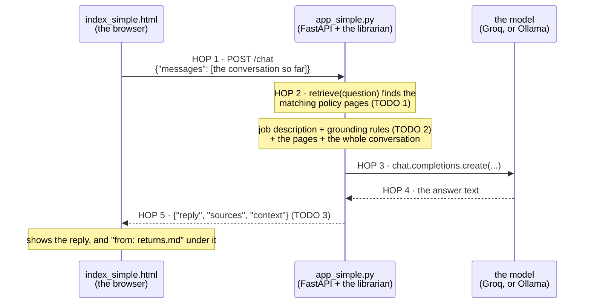

# Step 4 · Ground it  (LAB 4 · 12 min)

The 5 Bs: Brain → Bridge → Browser → **Book** → Body

## Table of contents

- [▶ Copy-paste: run this step](#-copy-paste-run-this-step)
- [What's in this folder](#whats-in-this-folder)
- [How `index_simple.html` + `app_simple.py` work](#how-index_simplehtml--app_simplepy-work)
- [Run it](#run-it)
- [CORE (everyone) · your TODOs in `app_simple.py` (or `app.py`)](#core-everyone--your-todos-in-app_simplepy-or-apppy)
- [Done when…](#done-when)
- [STRETCH · debug like a tester](#stretch--debug-like-a-tester)
- [Stuck?](#stuck)

## ▶ Copy-paste: run this step
**Needs:** virtual environment active · internet for Groq (or Ollama running) · this step **is** the server (the terminal stays busy). Stop any earlier `uvicorn` first (Ctrl+C). Run `retrieval.py` in a **second** terminal, or before you start the server.
> Terminal already shows `(.venv)` and you are in the project folder? Skip the first two commands.

**Windows (PowerShell)**
the folder that contains check_setup.py

```powershell
cd path\to\shopkart-ai-tutorial-v2
```

```powershell
.venv\Scripts\Activate.ps1
```

```powershell
cd build\step4_ground
```

what pages does the librarian find? (no model needed)

```powershell
python retrieval.py "Do you price-match?"
```

core. Then open http://localhost:8000

```powershell
uvicorn app_simple:app --reload
```

Ctrl+C to stop, then the stretch version:

```powershell
uvicorn app:app --reload
```

**Mac / Linux**
the folder that contains check_setup.py

```bash
cd path/to/shopkart-ai-tutorial-v2
```

```bash
source .venv/bin/activate
```

```bash
cd build/step4_ground
```

what pages does the librarian find? (no model needed)

```bash
python retrieval.py "Do you price-match?"
```

core. Then open http://localhost:8000

```bash
uvicorn app_simple:app --reload
```

Ctrl+C to stop, then the stretch version:

```bash
uvicorn app:app --reload
```

All commands in one place: [COMMANDS_WINDOWS.md](../../COMMANDS_WINDOWS.md) · [COMMANDS_MAC.md](../../COMMANDS_MAC.md)

**Slide 11.** Open the book before you answer. Before the model replies, the **librarian** (`retrieval.py`) finds the matching ShopKart policy pages and we put them into the context, with the rule *answer only from these pages*. That's **RAG** (Retrieval-Augmented Generation).

```
question ──► librarian ──► policy pages (shared/data/policies) ──┐
                                                                ├──► model ──► grounded answer
system prompt + conversation ───────────────────────────────────┘
```
**Wrong pages in → confident wrong answer out.**

Like steps 2 and 3, there are two versions. **Start with the simple one**; move to the full one when you're done.

## What's in this folder
| File | What it is | You edit it? |
|---|---|---|
| `app_simple.py` | the step 3 `app_simple.py` API, now with a tiny librarian written right inside the file (two small functions) | **yes: 3 TODOs** |
| `index_simple.html` | the finished step 3 simple page, which also shows the sources under each answer | no |
| `app.py` | the step 3 full `app.py` (all the extra endpoints), now with the librarian | yes: same 3 TODOs |
| `index.html` | the finished step 3 full page (saved chats, Show JSON, Orders, Agent mode ...). It shows a clickable **Sources:** row under each answer (click one to open that policy page) | no |
| `retrieval.py` | the full version's librarian: a smarter keyword search (rarer words count more). Used by `app.py` only | no (read it!) |

`app_simple.py` is self-contained: it reads the policy files and searches them itself, so there's nothing else to open. Both `app_simple.py` and `app.py` also have `POST /agent`, which switches on by itself in step 5 once `agent_simple.py` / `agent.py` sits next to them.

## How `index_simple.html` + `app_simple.py` work


## Run it
Simple version (start here):
```bash
cd build/step4_ground
```

```bash
uvicorn app_simple:app --reload
```

Full version (when you've finished the simple one):
```bash
uvicorn app:app --reload
```

Open **http://localhost:8000**.

**First, catch it bluffing.** Before you change anything, ask: *"Do you price-match?"* ShopKart has no such policy, but the bot will probably invent one.

Try the full version's librarian on its own:
```bash
python retrieval.py "Can I return shoes after 20 days?"
```

```bash
python retrieval.py "Do you price-match?"
```

## CORE (everyone) · your TODOs in `app_simple.py` (or `app.py`)

Each answer is already written between `BEGIN SOLUTION` and `END SOLUTION`. Uncomment only the code inside each block with **Ctrl+/** (Windows/Linux) or **Cmd+/** (Mac) (or the menu **Edit → Toggle Line Comment**, which works on every keyboard layout). Leave the markers commented and keep the placeholder assignments/returns: the uncommented code overrides them or returns first.

| TODO | What you do |
|---|---|
| 1 | Call the librarian: `pages = retrieve(question)` (full version: `retrieve(question, top_k=TOP_K)`). In the simple version `retrieve` is the function already in the file |
| 2 | Add the grounding rules to the system prompt (answer only from the pages, admit when it's not there, never invent) |
| 3 | Return the evidence too: `sources` and `context` |

## Done when…
- *"Do you price-match?"* gets an honest answer: not in our policy, plus an offer of a human.
- *"Can I return shoes after 20 days?"* says 30 days, and the page shows `returns.md` under the answer (full version: a clickable **Sources: Returns** button that opens the policy page).
- The terminal shows `librarian brought: [...]` for every question.
- Full version: with **Show JSON** ticked, you can point at `sources` and `context` in the response.

## STRETCH · debug like a tester
When a grounded bot is wrong, first ask **"what did the librarian bring?"**, not "is the model bad?" With the full version, set `SHOW_PROMPT=1` in `.env` and restart to see the full prompt. Then try `TOP_K=1` in `.env`: with fewer pages, which answers get worse?

## Stuck?
`solutions/step4_ground/app_simple.py` and `app.py` ·

```bash
python checkpoint.py step4
```

· bot ignores the pages → TROUBLESHOOTING.md #10
