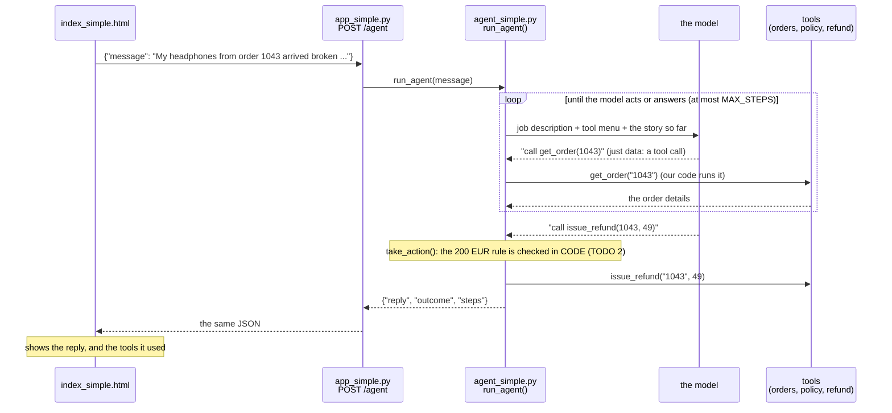
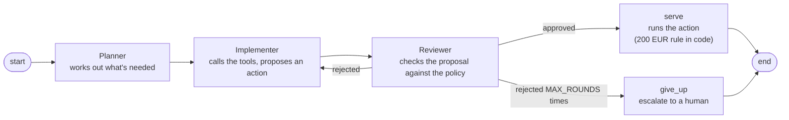

# Step 5 · Let it act  (LAB 5 · 18 min)

The 5 Bs: Brain → Bridge → Browser → Book → **Body** (hands that act)

**Slide 12.** Chatbots talk. Agents act. The bot gets **tools** (look up an order, read the policy, issue a refund, escalate to a human). The model never touches our systems: it only **asks** (`issue_refund(order_id="1043", amount=49)`). Our code decides. Every step is recorded in `steps` (the flight recorder), and Part 2 tests exactly that.

Like steps 2, 3 and 4, there are two versions. **Start with the simple one**; move to the full one when you're done.

| | Simple version | Full version |
|---|---|---|
| Who works | **one agent** in a loop | a **crew**: Planner → Implementer → Reviewer |
| Wired with | plain Python, one file | **LangGraph** |
| File you edit | `agent_simple.py` | `agent.py` |
| API | `app_simple.py` | `app.py` |
| Good for | understanding what an agent *is* | what Part 2 tests |

## What's in this folder
| File | What it is | You edit it? |
|---|---|---|
| `agent_simple.py` | one agent: tools, job description and a loop, all in one file. No LangGraph | **yes: 3 TODOs** |
| `app_simple.py` | the finished step 4 `app_simple.py`. Its `POST /agent` switches on because `agent_simple.py` is here | no |
| `index_simple.html` | the finished simple chat page. Tick **Agent mode** to talk to `/agent` | no |
| `agent.py` | the full crew: tools, prompts, LangGraph wiring | yes: 3 TODOs |
| `app.py` | the finished step 4 full API. `POST /agent` switches on because `agent.py` is here | no |
| `index.html`, `retrieval.py` | finished, from steps 3–4 | no |

## The simple version: one agent, one loop


The same thing as a conversation:


## The full version: a crew
```
customer message ──► Planner ──► Implementer ──tool calls──► shop systems (orders, refunds)
                                     ▲                │ proposal
                                     └── send back ── Reviewer ──approved──► serve (rules in CODE: >200 EUR → human)
```

What the crew adds to the single agent: a **Planner** that decides what to check first, and a **Reviewer** that double-checks every proposal against the policy *before* anything happens (the single agent has only the 200 EUR rule in code). It is wired with **LangGraph**, a small library for boxes and arrows. Every step lands in `steps`, and Part 2 tests exactly that.

## Run it
Run one order straight from the terminal, without the web page. Simple version first:
```bash
cd build/step5_agent
python agent_simple.py 1043      # broken headphones, 49 EUR → should refund
python agent_simple.py 2001      # laptop, 899 EUR → should go to a human
python agent_simple.py all       # all 10 seeded orders
```
Or start the API, then tick **Agent mode** in the chat page:
```bash
uvicorn app_simple:app --reload
```
Full version (when you've finished the simple one):
```bash
python agent.py 1043             # also: 2001, all, --graph
uvicorn app:app --reload
```
Open **http://localhost:8000** and try: *"My headphones from order 1043 arrived broken, refund please."*

## CORE (everyone) · your TODOs in `agent_simple.py`
| TODO | Where | What you do |
|---|---|---|
| 1 | section 2, the menu | Add the `escalate_to_human` tool, with a description that says *when* to use it |
| 2 | `take_action` | The 200 EUR rule, **in code**: big refunds always go to a human |
| 3 | end of `run_agent` | The circuit breaker: when the loop runs out of steps, hand over to a human |

The full version `agent.py` has 3 TODOs as well, the same ideas in crew form:

| TODO | Where | What you do |
|---|---|---|
| 1 | section 2, the menu | Add the `escalate_to_human` tool |
| 2 | `route_after_review` | The circuit breaker: serve if approved, send back if not, give up after `MAX_ROUNDS` |
| 3 | `serve` | The 200 EUR rule, **in code** |

## Done when…
- `python agent_simple.py 1043` ends with `-> {'action': 'refund', ... 'amount': 49.0}`.
- `python agent_simple.py 2001` ends with `-> {'action': 'escalate', ...}`, even if the model wanted to refund.
- In the chat page, Agent mode shows a line like `agent: get_order → read_policy → issue_refund · result: refund`.
- Full version: the chat page shows the whole step log: planner → implementer tool calls → reviewer → kitchen.

## STRETCH
- `python agent_simple.py all`: run all 10 seeded orders. Which outcomes would you argue with?
- Change `HUMAN_APPROVAL_LIMIT` to 100 and rerun order 1050 (89 EUR) and 1061 (120 EUR).
- Set `MAX_STEPS = 1` and run order 1043. What does the customer get? (That's the circuit breaker.)
- Full version: `python agent.py --graph`, then paste the output into https://mermaid.live to see the crew as a picture.

## Stuck?
`solutions/step5_agent/agent_simple.py` and `agent.py` · `python checkpoint.py step5` · model won't call tools → TROUBLESHOOTING.md #11 · agent loops → #12

**Part 2 tests the full version.** After the break, keep `uvicorn app:app --reload` (not `app_simple`) running here: the tests need the crew's `steps` and its chaos switches.
