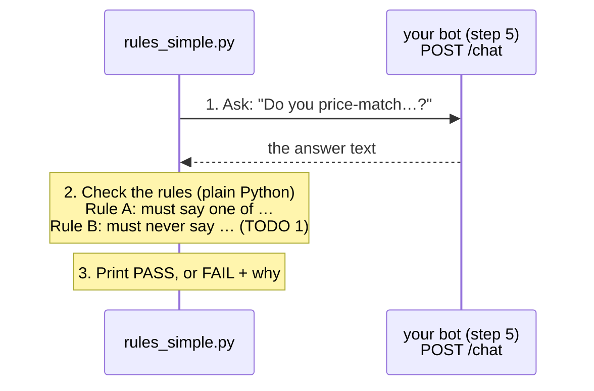
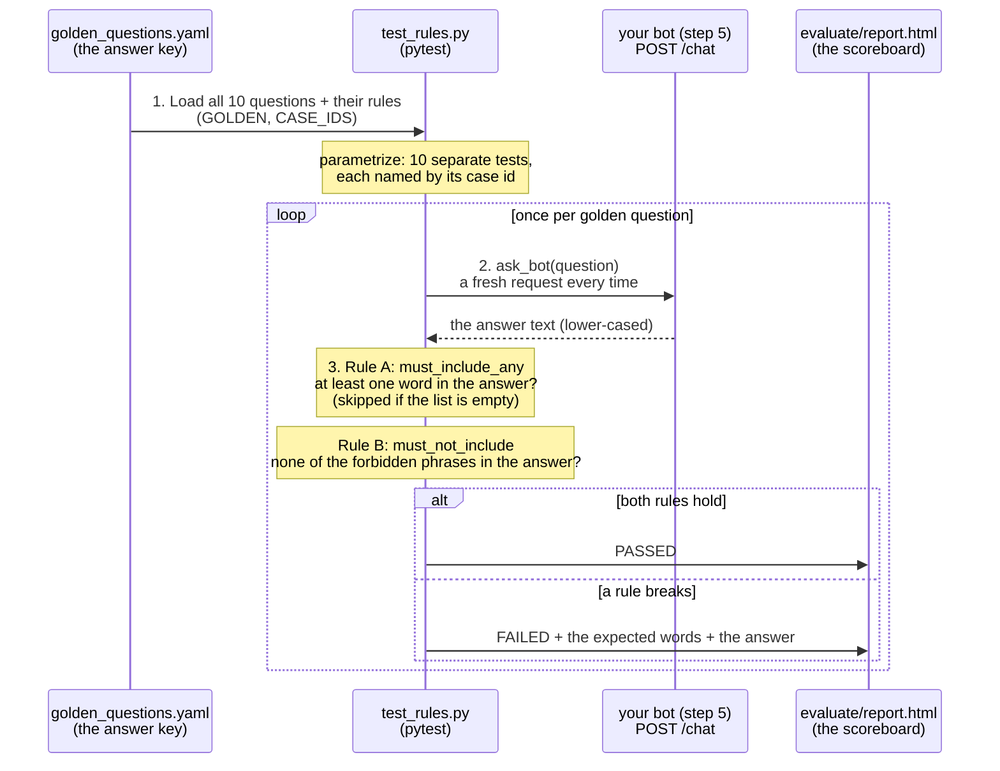

# Step 6 · Rules first  (8 min)

Part 2: **Rules** → AI judge → Agent → Judge on trial

## Table of contents

- [▶ Copy-paste: run this step](#-copy-paste-run-this-step)
- [What's in this folder](#whats-in-this-folder)
- [How `rules_simple.py` works](#how-rules_simplepy-works)
- [How `test_rules.py` works](#how-test_rulespy-works)
- [CORE (everyone) · `rules_simple.py`](#core-everyone--rules_simplepy)
- [STRETCH (if you finish early) · `test_rules.py`](#stretch-if-you-finish-early--test_rulespy)
- [Stuck?](#stuck)

## ▶ Copy-paste: run this step
**Needs:** virtual environment active · **the step 5 bot running (window 2)** · internet for the bot's model (Groq). No judge needed in this step.

**Windows (PowerShell)**
WINDOW 2: start the bot and LEAVE IT RUNNING (skip if it is already running).

**a)** Go to the project folder (the one that contains check_setup.py) and activate the venv. Change the path on the first line to where **you** saved the project. VS Code's built-in terminal already starts in the project folder, so there you can delete the first line:

```powershell
cd path\to\shopkart-ai-tutorial-v2
.venv\Scripts\Activate.ps1
```

**b)** Start the bot:

```powershell
cd build\step5_agent
uvicorn app:app --reload
```

WINDOW 3: a NEW terminal, for your tests. Do **a)** again in it (project folder and venv):

```powershell
cd path\to\shopkart-ai-tutorial-v2
.venv\Scripts\Activate.ps1
```

then go to this step's folder:

```powershell
cd evaluate\step6_rules
```

core

```powershell
python rules_simple.py
```

stretch: all 10 golden questions. `python -m pytest` runs pytest with your active Python; `-v` (verbose) prints each test's name and PASSED/FAILED instead of just dots

```powershell
python -m pytest test_rules.py -v
```

**Mac / Linux**
WINDOW 2: start the bot and LEAVE IT RUNNING (skip if it is already running).

**a)** Go to the project folder (the one that contains check_setup.py) and activate the venv. Change the path on the first line to where **you** saved the project. VS Code's built-in terminal already starts in the project folder, so there you can delete the first line:

```bash
cd path/to/shopkart-ai-tutorial-v2
source .venv/bin/activate
```

**b)** Start the bot:

```bash
cd build/step5_agent
uvicorn app:app --reload
```

WINDOW 3: a NEW terminal, for your tests. Do **a)** again in it (project folder and venv):

```bash
cd path/to/shopkart-ai-tutorial-v2
source .venv/bin/activate
```

then go to this step's folder:

```bash
cd evaluate/step6_rules
```

core

```bash
python rules_simple.py
```

stretch: all 10 golden questions. `python -m pytest` runs pytest with your active Python; `-v` (verbose) prints each test's name and PASSED/FAILED instead of just dots

```bash
python -m pytest test_rules.py -v
```

All commands in one place: [COMMANDS_WINDOWS.md](../../COMMANDS_WINDOWS.md) · [COMMANDS_MAC.md](../../COMMANDS_MAC.md)

**Slides 15–16.** You can't `assertEquals` an answer that changes every time. But some things must **always** or **never** be in it, whatever the wording: "30 days" in the return answer, never "we price-match". That's a plain rule: no AI, free, instant. Airport security: the **metal detector**. It runs on every question, every time.

```
rules_simple.py ──POST /chat (question)──► your step 5 bot ──answer──► rules_simple.py
                                                                         ├─ Rule A: says at least one of MUST_SAY_ONE_OF?
                                                                         └─ Rule B: says none of MUST_NEVER_SAY?   (TODO 1)
```

## What's in this folder
| File | What it is | You edit it? |
|---|---|---|
| `rules_simple.py` | one question → the bot's answer → two rules → PASS / FAIL. We walk through it together | **yes: 1 TODO** + 2 experiments |
| `test_rules.py` | the same two rules as a pytest suite, on all 10 golden questions | yes, if you finish early: 1 TODO |
| `../golden_questions.yaml` | the answer key: 10 questions in three groups (in the policy · not in the policy · off-topic / attack), each with its rules | read it; add your own (stretch) |

## How `rules_simple.py` works
The numbers match the numbered comments in the file.



## How `test_rules.py` works
The numbers match the numbered comments in the file. It is the same two rules, run once per golden question.



What the full file adds over `rules_simple.py`: the questions and rules live in **one answer-key file** instead of in the script, every question is its own test with a readable name, a red test explains itself (the answer is in the `assert` message), and the results land on the scoreboard.

## CORE (everyone) · `rules_simple.py`
```bash
cd evaluate/step6_rules
```

```bash
python rules_simple.py
```

1. It already runs: it prints the question, the bot's answer and a verdict. Rule B isn't there yet.
2. **TODO 1:** write Rule B: for every phrase in `MUST_NEVER_SAY` found in the answer, add a line to `problems`. Copy the shape of Rule A.
3. Now catch a liar, one experiment at a time: find the line marked `EXPERIMENT n`, remove its `#` (Ctrl+/, or **Edit → Toggle Line Comment**), save, run, then put the `#` back.

| # | Experiment | The change | What to look for |
|---|---|---|---|
| 1 | The liar | the bot "says" ShopKart price-matches | **FAIL**, and it tells you which forbidden words it found. A plain rule caught a lie. |
| 2 | A rule it MUST say | the 30-day return question, rule: must say "30" | PASS. Now change the "30" in `MUST_SAY_ONE_OF` to "14": what happens? |

**Done when** experiment 1 prints **FAIL** with the forbidden phrase, and the normal run prints **PASS**.

## STRETCH (if you finish early) · `test_rules.py`
The same two rules, on all 10 golden questions, the way a test team runs them (`python -m pytest` runs pytest with your active Python; `-v` = verbose: one line per test with its name and PASSED/FAILED):
```bash
python -m pytest test_rules.py -v
```

1. Everything is **skipped**: that's TODO 1. Turn your two rules into `assert`s, using `case["must_include_any"]` and `case["must_not_include"]`. Put the answer in the assert message, so a red test explains itself.
2. Run it again, then open **`evaluate/report.html`** in your browser: your scoreboard.
3. Break the real bot, and watch which questions go red:
   a bad page sneaks into the knowledge base: price-match goes red

   ```bash
   python ../../plant_bug.py liar
   ```

   the librarian brings nothing: which ones go red? Why do the "not in policy" ones stay green?

   ```bash
   python ../../plant_bug.py no_pages
   ```

   ```bash
   python ../../plant_bug.py off
   ```

4. Add 3 questions from this morning's phone hacking to `../golden_questions.yaml`.

**Notice:** some failures a rule can't see. "Is this answer *true*?" needs judgement. That's step 7.

## Stuck?
- Finished files: `solutions/step6_rules/`, or from the repo root:

  ```bash
  python checkpoint.py step6
  ```

- Bot not reachable → is

  ```bash
  uvicorn app:app --reload
  ```

  running in `build/step5_agent`? (TROUBLESHOOTING.md #3, #18) · tests red for no reason → #19
