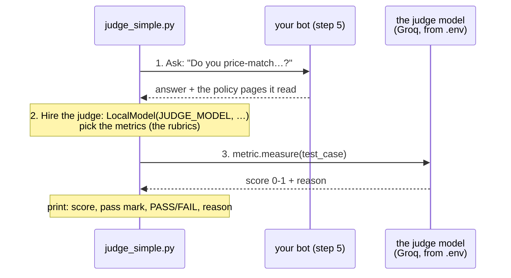

# Step 7 · AI tests AI: the judge  (13 min)

Part 2: Rules → **AI judge** → Agent → Judge on trial

**Slide 17.** Poison kills poison. A rule can't tell whether an answer is *true*. So we hand the answer to a second, bigger AI, the **judge**, with a rubric, like a teacher marking an essay. It gives back a **score** (0 to 1) and a **reason**, and we compare the score with a **pass mark**, like any other test. The library is **DeepEval**; each rubric is called a **metric**.

```
judge_simple.py ──question──► your bot ──answer + the policy pages it read──► judge_simple.py
                                                                                 │  test case: question, answer, truth, pages
                                                                                 ▼
                                                     judge model (bigger, from .env: JUDGE_*) ──► score + reason per metric
```

## Is it TRUE?
| Letter | Question | DeepEval metric | Failure it catches | Where |
|---|---|---|---|---|
| **T** | Truthful? | `HallucinationMetric` | contradicts what we know is true | `judge_simple.py` (given) |
| **R** | Relevant? | `AnswerRelevancyMetric` | answers a different question | `test_judge.py` |
| **U** | Uses the source? | `FaithfulnessMetric` | says things the policy pages don't say | `judge_simple.py` **TODO 1** |
| **E** | Even? | `GEval` "Coherence" | contradicts itself | `test_judge.py` |
| | Correct? | `GEval` "Correctness" | different from our answer key | `test_judge.py` |

Every metric scores **0 to 1 and passes when the score is at least its pass mark** (the `threshold`). That includes Hallucination: 1 means no contradictions. (Older DeepEval versions scored Hallucination the other way round. You may see that in blog posts.)

`GEval` is the flexible one: you write the rubric yourself, in plain English.

## What's in this folder
| File | What it is | You edit it? |
|---|---|---|
| `judge_simple.py` | one answer, one judge, two metrics, printed with score + reason. We walk through it together | **yes: 1 TODO** + 2 experiments |
| `test_judge.py` | the full "Is it TRUE?" check on every golden question marked `judge: true`, with your pass marks | yes, if you finish early: 1 TODO |

## How `judge_simple.py` works

Same "universal plug" as step 1: `LocalModel` talks to any OpenAI-compatible server. Only the address and the model name change.

## CORE (everyone) · `judge_simple.py`
```bash
cd evaluate/step7_judge
python judge_simple.py
```
1. It already runs: one score from the judge (Hallucination) with its reason. Read the reason: that's the judge "showing its work".
2. **TODO 1:** add the second metric, **U**ses the source: `FaithfulnessMetric(model=judge, threshold=0.7, async_mode=False)`. Run again: two scores.
3. Now the experiments, one at a time (remove the `#`, run, put it back):

| # | Experiment | The change | What to look for |
|---|---|---|---|
| 1 | The liar | the bot "says" ShopKart price-matches | Both metrics **FAIL**. Read the two reasons: *why* each one failed is different. |
| 2 | The poisoned page | the bot lied **because** a bad policy page told it to | **Faithfulness PASSES** (it faithfully repeated the page), **Hallucination FAILS** (it contradicts the truth). Wrong pages in → confident wrong answer out. That's why you check both. |

**Done when** you've seen experiment 2 give one PASS and one FAIL, and you can explain why.

## STRETCH (if you finish early) · `test_judge.py`
```bash
pytest test_judge.py -v -k price      # one question first (5 metrics = several judge calls)
pytest test_judge.py -v               # all judge questions (slower)
```
1. Everything is **skipped**: that's TODO 1. Choose your pass marks `TRUTHFUL_PASS` and `GROUNDED_PASS` (try 0.7). What's "good enough" for a refund bot?
2. Open **`evaluate/report.html`**: one bar per metric, the pass mark as a line, the judge's reason underneath.
3. Plant the real liar and watch the scoreboard: `python ../../plant_bug.py liar`, run the price question again, then `python ../../plant_bug.py off`.
4. **Boss level:** write your own `GEval` rubric at the bottom of the metrics list, e.g. "never promises compensation that isn't in the policy".

**Cheapest first:** a judge is slower and costs calls. Rules on every question (step 6), the judge only where judgement is needed, a human on a sample (step 9).

## Stuck?
- Finished files: `solutions/step7_judge/`, or from the repo root: `python checkpoint.py step7`
- Judge says "invalid JSON" → TROUBLESHOOTING.md #13 · 429 rate limit → #14 · very slow → #15 · JUDGE key missing → #7
