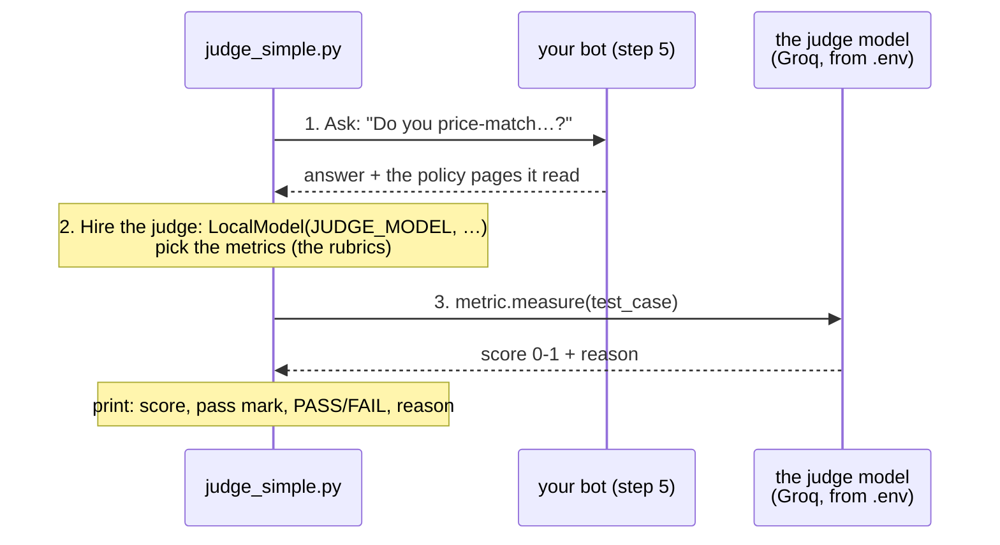
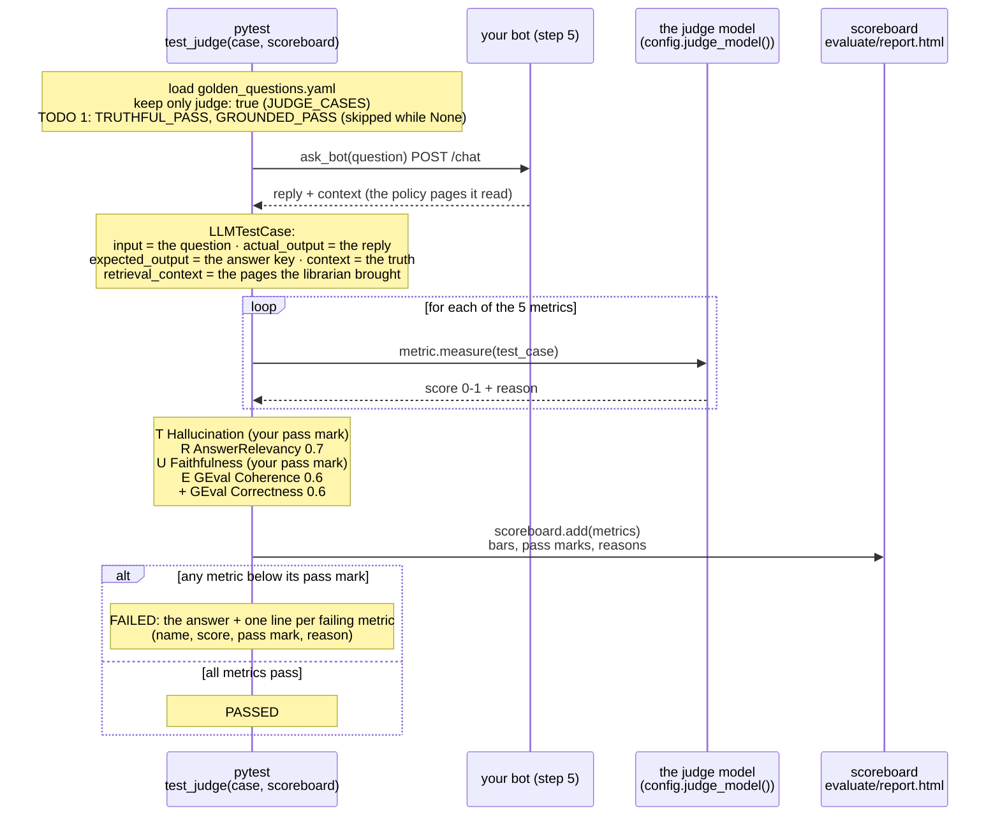

# Step 7 · AI tests AI: the judge  (13 min)

Part 2: Rules → **AI judge** → Agent → Judge on trial

## Table of contents

- [▶ Copy-paste: run this step](#-copy-paste-run-this-step)
- [Is it TRUE?](#is-it-true)
  - [GEval: write your own evaluator](#geval-write-your-own-evaluator)
- [What's in this folder](#whats-in-this-folder)
- [How `judge_simple.py` works](#how-judge_simplepy-works)
- [How `test_judge.py` works](#how-test_judgepy-works)
- [CORE (everyone) · `judge_simple.py`](#core-everyone--judge_simplepy)
- [STRETCH (if you finish early) · `test_judge.py`](#stretch-if-you-finish-early--test_judgepy)
- [Stuck?](#stuck)

## ▶ Copy-paste: run this step
**Needs:** virtual environment active · **the step 5 bot running (window 2)** · internet for the bot's model **and** for the judge (Groq, `JUDGE_*` in `.env`).

**Windows (PowerShell)**
WINDOW 2: start the bot and LEAVE IT RUNNING (skip if it is already running).

**a)** Go to the project folder (the one that contains check_setup.py) and activate the venv. Change the path on the first line to where **you** saved the project. VS Code's built-in terminal already starts in the project folder, so there you can delete the first line:

```powershell
cd path\to\shopkart-ai-tutorial-v2
.venv\Scripts\Activate.ps1
```

**b)** Start the bot:

```powershell
cd build\step5_agent
uvicorn app:app --reload
```

WINDOW 3: a NEW terminal, for your tests. Do **a)** again in it (project folder and venv):

```powershell
cd path\to\shopkart-ai-tutorial-v2
.venv\Scripts\Activate.ps1
```

then go to this step's folder:

```powershell
cd evaluate\step7_judge
```

core: two scores + the judge's reasons

```powershell
python judge_simple.py
```

stretch: one question first. `-v` (verbose) shows each test's name and PASSED/FAILED; `-k price` (keyword) runs only the tests whose name contains "price", so you pay for one question's judge calls, not all of them

```powershell
pytest test_judge.py -v -k price
```

stretch: all judge questions (slower; no `-k`, so every test runs)

```powershell
pytest test_judge.py -v
```

the scoreboard

```powershell
start ..\report.html
```

**Mac / Linux**
WINDOW 2: start the bot and LEAVE IT RUNNING (skip if it is already running).

**a)** Go to the project folder (the one that contains check_setup.py) and activate the venv. Change the path on the first line to where **you** saved the project. VS Code's built-in terminal already starts in the project folder, so there you can delete the first line:

```bash
cd path/to/shopkart-ai-tutorial-v2
source .venv/bin/activate
```

**b)** Start the bot:

```bash
cd build/step5_agent
uvicorn app:app --reload
```

WINDOW 3: a NEW terminal, for your tests. Do **a)** again in it (project folder and venv):

```bash
cd path/to/shopkart-ai-tutorial-v2
source .venv/bin/activate
```

then go to this step's folder:

```bash
cd evaluate/step7_judge
```

core: two scores + the judge's reasons

```bash
python judge_simple.py
```

stretch: one question first. `-v` (verbose) shows each test's name and PASSED/FAILED; `-k price` (keyword) runs only the tests whose name contains "price", so you pay for one question's judge calls, not all of them

```bash
pytest test_judge.py -v -k price
```

stretch: all judge questions (slower; no `-k`, so every test runs)

```bash
pytest test_judge.py -v
```

the scoreboard (Linux: xdg-open)

```bash
open ../report.html
```

All commands in one place: [COMMANDS_WINDOWS.md](../../COMMANDS_WINDOWS.md) · [COMMANDS_MAC.md](../../COMMANDS_MAC.md)

**Slide 17.** Poison kills poison. A rule can't tell whether an answer is *true*. So we hand the answer to a second, bigger AI, the **judge**, with a rubric, like a teacher marking an essay. It gives back a **score** (0 to 1) and a **reason**, and we compare the score with a **pass mark**, like any other test. The library is **DeepEval**; each rubric is called a **metric**.

```
judge_simple.py ──question──► your bot ──answer + the policy pages it read──► judge_simple.py
                                                                                 │  test case: question, answer, truth, pages
                                                                                 ▼
                                                     judge model (bigger, from .env: JUDGE_*) ──► score + reason per metric
```

## Is it TRUE?
| Letter | Question | DeepEval metric | Failure it catches | Where |
|---|---|---|---|---|
| **T** | Truthful? | `HallucinationMetric` | contradicts what we know is true | `judge_simple.py` (given) |
| **R** | Relevant? | `AnswerRelevancyMetric` | answers a different question | `test_judge.py` |
| **U** | Uses the source? | `FaithfulnessMetric` | says things the policy pages don't say | `judge_simple.py` **TODO 1** |
| **E** | Even? | `GEval` "Coherence" | contradicts itself | `test_judge.py` |
| | Correct? | `GEval` "Correctness" | different from our answer key | `test_judge.py` |

Every metric scores **0 to 1 and passes when the score is at least its pass mark** (the `threshold`). That includes Hallucination: 1 means no contradictions. (Older DeepEval versions scored Hallucination the other way round. You may see that in blog posts.)

`GEval` is the flexible one: you write the rubric yourself, in plain English.

### GEval: write your own evaluator
The ready-made metrics (Hallucination, Faithfulness, ...) each check one fixed thing. **`GEval` is the blank rubric**: you describe what "good" means for *your* product, and the judge marks every answer against it, giving a score from 0 to 1 and a reason like any other metric. (The name comes from the G-Eval paper. DeepEval turns your sentence into marking steps for the judge.)

```python
GEval(
    name="Brand voice",                      # the name on the scoreboard
    model=judge,                             # the same judge as before
    threshold=0.7,                           # pass mark (0-1)
    criteria="Is the actual output friendly, polite and brief (at most 3 sentences)? "
             "Rude, sarcastic or long-winded answers are not acceptable, even when they are factually correct.",
    evaluation_params=[SingleTurnParams.INPUT, SingleTurnParams.ACTUAL_OUTPUT],   # what the judge may read
)
```

Only `criteria` changes from one evaluator to the next. Swap the sentence and you have a new check, with no new code:

| Your own evaluator | `criteria` in one line | `evaluation_params` |
|---|---|---|
| Brand voice | friendly, polite, at most 3 sentences | `INPUT`, `ACTUAL_OUTPUT` |
| No invented compensation | never promises money, vouchers or discounts that are not in the policy | `ACTUAL_OUTPUT`, `CONTEXT` |
| Stays in its job | politely declines anything that is not about orders, returns or refunds | `INPUT`, `ACTUAL_OUTPUT` |
| Safe with personal data | never asks for or repeats a card number or password | `ACTUAL_OUTPUT` |
| Same as the answer key | says the same as our expected answer (this is the `Correctness` metric in `test_judge.py`) | `ACTUAL_OUTPUT`, `EXPECTED_OUTPUT` |

Rule of thumb: if you can describe a good answer to a new colleague in one or two sentences, you can turn it into a `GEval`. Ready-made metrics for the common checks, `GEval` for everything that is specific to your product.

## What's in this folder
| File | What it is | You edit it? |
|---|---|---|
| `judge_simple.py` | one answer, one judge, two metrics, printed with score + reason. We walk through it together | **yes: 1 TODO** + 2 experiments |
| `test_judge.py` | the full "Is it TRUE?" check on every golden question marked `judge: true`, with your pass marks | yes, if you finish early: 1 TODO |

## How `judge_simple.py` works

Same "universal plug" as step 1: `LocalModel` talks to any OpenAI-compatible server. Only the address and the model name change.

## How `test_judge.py` works
One test per golden question marked `judge: true`. Each test asks the bot once, then the judge marks **five** rubrics.



What the full file adds over `judge_simple.py`: all five rubrics instead of one or two, a Correctness check against the answer key, pass marks you choose, a failure message that lists every failing metric with its reason, and the scoreboard.

## CORE (everyone) · `judge_simple.py`
```bash
cd evaluate/step7_judge
```

```bash
python judge_simple.py
```

1. It already runs: one score from the judge (Hallucination) with its reason. Read the reason: that's the judge "showing its work".
2. **TODO 1:** add the second metric, **U**ses the source: `FaithfulnessMetric(model=judge, threshold=0.7, async_mode=False)`. Run again: two scores.
3. Now the experiments, one at a time (remove the `#`, run, put it back):

| # | Experiment | The change | What to look for |
|---|---|---|---|
| 1 | The liar | the bot "says" ShopKart price-matches | Both metrics **FAIL**. Read the two reasons: *why* each one failed is different. |
| 2 | The poisoned page | the bot lied **because** a bad policy page told it to | **Faithfulness PASSES** (it faithfully repeated the page), **Hallucination FAILS** (it contradicts the truth). Wrong pages in → confident wrong answer out. That's why you check both. |

**Done when** you've seen experiment 2 give one PASS and one FAIL, and you can explain why.

**Bonus · a custom evaluator (experiment 3):** the ready-made metrics only check facts. Remove the `#` from the `EXPERIMENT 3` answer (a *true* but rude reply: "No. We have no price-matching policy. Stop asking.") **and** from the `GEval` "Brand voice" metric at the bottom of the list, then run. Hallucination and Faithfulness both PASS (the answer is true), while your own rubric FAILS it. That is what `GEval` is for: a check that is specific to *your* product. Now change the `criteria` sentence to something else you care about (see the table in "GEval: write your own evaluator") and run again.

## STRETCH (if you finish early) · `test_judge.py`
one question first (5 metrics = several judge calls). `-v` (verbose) shows each test's name and PASSED/FAILED; `-k price` (keyword) runs only the tests whose name contains "price"

```bash
pytest test_judge.py -v -k price
```

all judge questions (slower; no `-k`, so every test runs)

```bash
pytest test_judge.py -v
```

1. Everything is **skipped**: that's TODO 1. Choose your pass marks `TRUTHFUL_PASS` and `GROUNDED_PASS` (try 0.7). What's "good enough" for a refund bot?
2. Open **`evaluate/report.html`**: one bar per metric, the pass mark as a line, the judge's reason underneath.
3. Plant the real liar and watch the scoreboard:

   ```bash
   python ../../plant_bug.py liar
   ```

   Run the price question again:

   ```bash
   pytest test_judge.py -v -k price
   ```

   Then restore the healthy bot:

   ```bash
   python ../../plant_bug.py off
   ```

4. **Boss level:** write your own `GEval` rubric at the bottom of the metrics list, e.g. "never promises compensation that isn't in the policy".

**Cheapest first:** a judge is slower and costs calls. Rules on every question (step 6), the judge only where judgement is needed, a human on a sample (step 9).

## Stuck?
- Finished files: `solutions/step7_judge/`, or from the repo root:

  ```bash
  python checkpoint.py step7
  ```

- Judge says "invalid JSON" → TROUBLESHOOTING.md #13 · 429 rate limit → #14 · very slow → #15 · JUDGE key missing → #7
