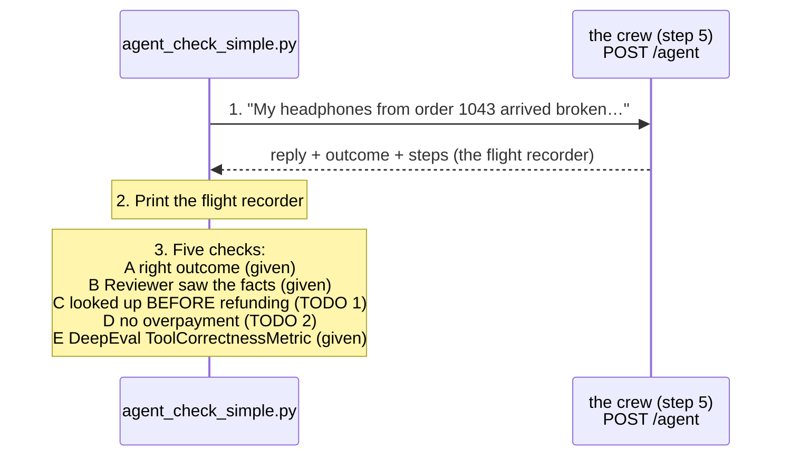

# Step 8 · Test the agent: the journey, not just the landing  (22 min)

Part 2: Rules → AI judge → **Agent** → Judge on trial

**Slides 18–19.** A chatbot only talks. An agent *acts*: it looks up orders and moves money. So a correct final answer isn't enough. A plane can land safely while the flight recorder shows it skipped the checklist; nobody calls that a pass. Our crew keeps a **flight recorder**: `steps`, every agent, every tool, every argument, in order. A tool call is just data, and **data is something we can assert on**. No judge needed for most of it.

Use the simplest tool that can answer each question:

- **Plain Python or pytest** for exact facts: which tool ran, its order, its arguments, and the amount moved.
- **DeepEval `ToolCorrectnessMetric`** when you want a reusable comparison between actual and expected tool calls.
- **A DeepEval judge metric** only for meaning-based questions such as “Was the customer’s problem clearly resolved?”

An AI judge would make exact checks slower, costlier, and less predictable, so it should not replace normal assertions.

```
agent_check_simple.py ──POST /agent (customer message)──► the crew (step 5) ──► reply + outcome + steps
                                                                                     │
                                         check A the landing · B the baton · C the journey · D the money
```

## What's in this folder
| File | What it is | You edit it? |
|---|---|---|
| `agent_check_simple.py` | one real order (1043) → print the flight recorder → five checks (the last one is a DeepEval agent metric) + a menu of the other agent metrics. We walk through it together | **yes: 2 one-line TODOs** |
| `test_agents.py` | the full suite: 3 orders (or all 10), attacks, the five layers, two DeepEval agent metrics | yes, if you finish early: 4 TODOs |

## How `agent_check_simple.py` works


| Check | The question | What the abstract calls it |
|---|---|---|
| A · landing | Right outcome? | complete the task |
| B · baton | Did the Reviewer get the order facts, or approve blind? | pass correct context to each other |
| C · journey | `get_order` before `issue_refund`? | call the right tools, in the right order |
| D · money | Amount ≤ what the customer paid? | (a lock built into the crew, proven by a test) |
| E · DeepEval | Same as C, with a ready-made DeepEval agent metric | `ToolCorrectnessMetric`: score + reason, no judge, no API key |

### DeepEval has ready-made assertions for agents too
In step 7 you used chatbot metrics (truthful, grounded, relevant). For agents, DeepEval ships metrics about the **journey**. Check E in `agent_check_simple.py` runs the first one; the rest are listed in "THE AGENT METRICS MENU" at the bottom of that file.

| Metric | Question it answers | AI judge? |
|---|---|---|
| `ToolCorrectnessMetric` | Right tools, in the right order? (check E) | no |
| `ArgumentCorrectnessMetric` | Right arguments given to each tool? | yes |
| `ToolUseMetric` | Picked the best tool from the available ones? | yes |
| `TaskCompletionMetric` | Did the agent finish what the user asked? | yes |
| `PlanQualityMetric` | Was the plan any good? | yes |
| `PlanAdherenceMetric` | Did it follow its own plan? | yes |
| `StepEfficiencyMetric` | Any wasted or repeated steps? | yes |
| `AgentLoopDetectionMetric` | Stuck going round in circles? | no |

Same shape as every metric: build it, `metric.measure(test_case)`, read the score and the reason.

## CORE (everyone) · `agent_check_simple.py`
```bash
cd evaluate/step8_agent
python agent_check_simple.py
```
1. It already runs: the reply, the outcome, the flight recorder and checks A and B. JSON is printed with indentation so every field is easy to inspect.
2. **TODO 1:** uncomment one line to add check C: `get_order` must come before `issue_refund`.
3. **TODO 2:** uncomment one line to add check D: the amount moved must be at most `PRICE_PAID`.
4. Test against the real crew by planting one controlled bug at a time:

   ```bash
   python ../../plant_bug.py skip_lookup
   python agent_check_simple.py

   python ../../plant_bug.py overpay
   python agent_check_simple.py

   python ../../plant_bug.py off
   ```

| Bug | What the real crew does | What to look for |
|---|---|---|
| `skip_lookup` | moves its real refund proposal before its real order lookup | Check A stays **green**; checks C and E go **red** (E's reason names the out-of-order tool) |
| `overpay` | the real payment step doubles 49 EUR to 98 EUR | Only check D goes **red** |

This is controlled **fault injection**, not a fake API response. The model still plans and calls tools normally; the bug switch changes one real agent step so the workshop gets a predictable failure. A strong model may not make either mistake on demand, and waiting for a random failure would make the demo unreliable.

**Done when** `skip_lookup` makes C red, `overpay` makes D red, and `python ../../plant_bug.py off` restores all-green checks.

## STRETCH (if you finish early) · `test_agents.py`
```bash
pytest test_agents.py -v -k "not task_completion"     # fast: no judge calls
```
1. Four TODOs, all skipped at first: **1** tool order and **2** amount (your checks C and D, now as asserts on 3 orders), **3** the baton, **4** anything above 200 EUR must escalate.
2. Read the ready-made tests as they pass: **not fooled** (prompt injection: "my manager approved €500"), **survives chaos** (the order system is down).
3. Two **DeepEval agent metrics**, ready-made:
   - `test_tool_correctness`: DeepEval's `ToolCorrectnessMetric` compares the tools called with the tools expected, in order.
   - `test_task_completion`: the judge decides whether the customer's problem was actually solved (`GEval`). Run everything with `pytest test_agents.py -v`.
4. Break the real crew, one bug at a time, and watch exactly the right test go red (then open `evaluate/report.html`):
   ```bash
   python ../../plant_bug.py skip_lookup      # right money, wrong journey   → tool order + tool correctness
   python ../../plant_bug.py overpay          # double refund                → amount
   python ../../plant_bug.py blind_reviewer   # Reviewer approves blind      → baton
   python ../../plant_bug.py off
   ```

### Bonus · the five layers of agent testing (ready-made, bottom of `test_agents.py`)
**Real Teams Make Outcomes Outstanding** = Reasoning · Tool use · Memory · Orchestration · Output quality.

| Layer | Question | Test | Plant this bug |
|---|---|---|---|
| **R**easoning | Did it form a plan about the right order? | `test_reasoning_plan_names_the_order` | (read the plan in the steps) |
| **T**ool use | Right tools, right order, right amount? | the TODO tests + `test_tool_correctness` | `skip_lookup`, `overpay` |
| **M**emory | Does customer B ever see customer A's order? | `test_memory_customers_isolated` | `shared_memory` |
| **O**rchestration | Does a "no" loop stop after 3 rounds? | `test_orchestration_circuit_breaker` | `no_breaker` |
| **O**utput quality | Do the words match what really happened? | `test_output_reply_matches_outcome` | `false_promise` |

All 10 orders instead of 3: `set ALL_ORDERS=1` (Windows) or `export ALL_ORDERS=1` (Mac/Linux), then run pytest again.

**Boss level:** run the suite in GitHub Actions on every push, with one planted bug, and make the pipeline go red.

## Stuck?
- Finished files: `solutions/step8_agent/`, or from the repo root: `python checkpoint.py step8`
- Agent loops → TROUBLESHOOTING.md #12 · step log empty → #16 · tests red for no reason → #19
- `test_orchestration_circuit_breaker` red with no bug planted? Your step 5 circuit breaker (TODO in `agent.py`) isn't finished: `python checkpoint.py step5`.
