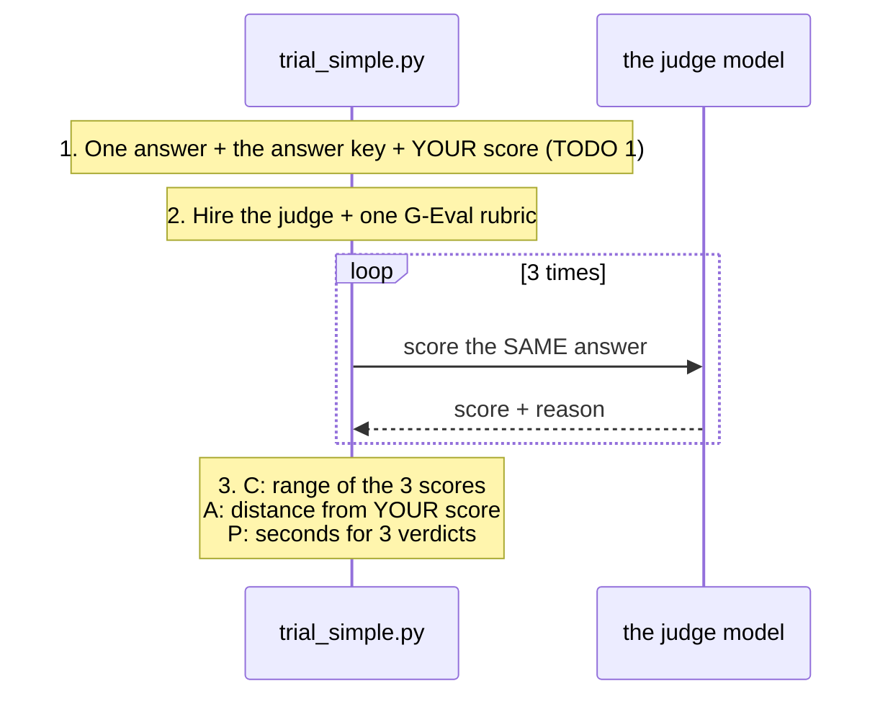
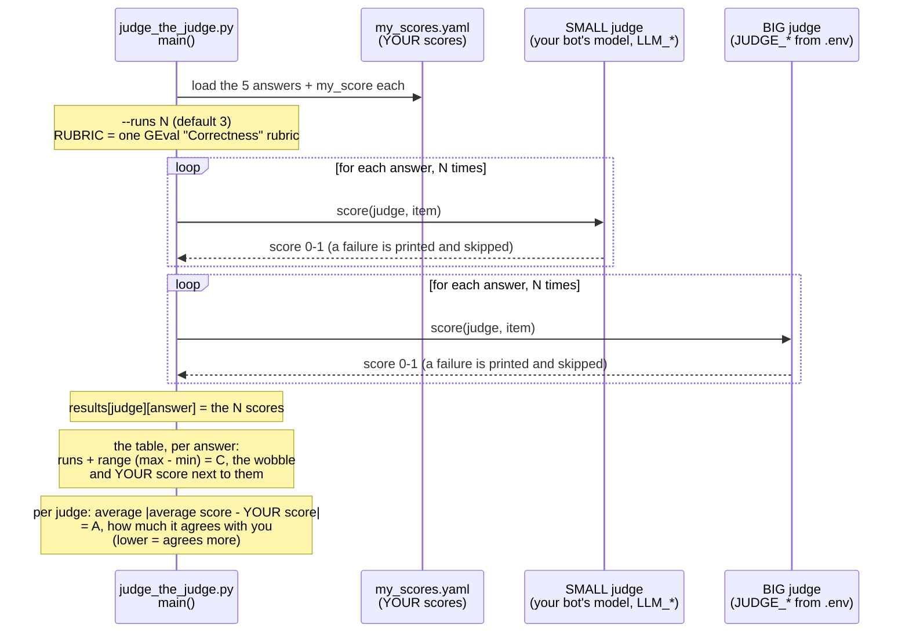

# Step 9 · Put the judge on trial  (17 min)

Part 2: Rules → AI judge → Agent → **Judge on trial**

## Table of contents

- [▶ Copy-paste: run this step](#-copy-paste-run-this-step)
- [What's in this folder](#whats-in-this-folder)
- [How `trial_simple.py` works](#how-trial_simplepy-works)
- [How `judge_the_judge.py` works](#how-judge_the_judgepy-works)
- [CORE (everyone) · `trial_simple.py`](#core-everyone--trial_simplepy)
- [STRETCH (if you finish early) · `judge_the_judge.py`](#stretch-if-you-finish-early--judge_the_judgepy)
- [Boss level](#boss-level)
- [Stuck?](#stuck)

## ▶ Copy-paste: run this step
**Needs:** virtual environment active · internet for the judge (Groq, `JUDGE_*` in `.env`) · the bot is **not** needed (we judge fixed answers).

**Windows (PowerShell)**
Open a terminal. **The bot is not needed here**: if it is still running from steps 6 to 8, leave it alone and open a NEW terminal for this step.

**a)** Go to the project folder (the one that contains check_setup.py) and activate the venv. Change the path on the first line to where **you** saved the project. VS Code's built-in terminal already starts in the project folder, so there you can delete the first line:

```powershell
cd path\to\shopkart-ai-tutorial-v2
.venv\Scripts\Activate.ps1
```

**b)** Go to this step's folder:

```powershell
cd evaluate\step9_trial
```

core: one answer, scored 3 times (fill in MY_SCORE first!)

```powershell
python trial_simple.py
```

stretch: both judges, five answers (fill in my_scores.yaml first!). `--runs 2` means: score every answer 2 times per judge (the default is 3), so you can see how much each judge wobbles. A smaller number means fewer calls, which helps if you hit rate limits

```powershell
python judge_the_judge.py --runs 2
```

**Mac / Linux**
Open a terminal. **The bot is not needed here**: if it is still running from steps 6 to 8, leave it alone and open a NEW terminal for this step.

**a)** Go to the project folder (the one that contains check_setup.py) and activate the venv. Change the path on the first line to where **you** saved the project. VS Code's built-in terminal already starts in the project folder, so there you can delete the first line:

```bash
cd path/to/shopkart-ai-tutorial-v2
source .venv/bin/activate
```

**b)** Go to this step's folder:

```bash
cd evaluate/step9_trial
```

core: one answer, scored 3 times (fill in MY_SCORE first!)

```bash
python trial_simple.py
```

stretch: both judges, five answers (fill in my_scores.yaml first!). `--runs 2` means: score every answer 2 times per judge (the default is 3), so you can see how much each judge wobbles. A smaller number means fewer calls, which helps if you hit rate limits

```bash
python judge_the_judge.py --runs 2
```

All commands in one place: [COMMANDS_WINDOWS.md](../../COMMANDS_WINDOWS.md) · [COMMANDS_MAC.md](../../COMMANDS_MAC.md)

**Slide 20.** Our judge is AI too, so it can be wrong. Antivenom is tested before it's used, and so must our judge be. **Put a CAP on the judge:**

| | Question | How | Everyday version |
|---|---|---|---|
| **C** | Consistent? | **Repeat it:** score the same answer 3 times. How far apart? | a cheap bathroom scale: weigh three times, report the range |
| **A** | Agrees with you? | **Compare it:** score it yourself first, then check the judge agrees | a new teacher's marks, checked against the senior teacher |
| **P** | Price? | **Count it:** judge calls × time (and tokens × price) | a taxi meter running |

The bot doesn't need to run for this step: we judge fixed answers.

## What's in this folder
| File | What it is | You edit it? |
|---|---|---|
| `trial_simple.py` | one answer, scored 3 times by one judge, then C · A · P printed. We walk through it together | **yes: 1 TODO** + 2 experiments |
| `judge_the_judge.py` | both judges (your bot's small model vs the big judge), five answers, a comparison table | no (stretch: the rubric) |
| `my_scores.yaml` | the five answers. **You** score them first | yes |

## How `trial_simple.py` works


## How `judge_the_judge.py` works
The same trial, but for **two judges** and **five answers**, all in one run.



What the full file adds over `trial_simple.py`: two judges side by side, five answers instead of one, `--runs` to trade accuracy against rate limits, failures that are printed instead of stopping the run, and one comparison table. It prints the wobble (C) and the agreement (A) for you to read. The rubric at the top is the thing to tweak.

## CORE (everyone) · `trial_simple.py`
1. **TODO 1, before you run anything:** read the answer in part 1 ("…but there is a 5 EUR restocking fee") and give it **your own** score in `MY_SCORE` (0 = wrong, 1 = perfect). No peeking.
2. Run it:
   ```bash
   cd evaluate/step9_trial
   ```

   ```bash
   python trial_simple.py
   ```

3. The experiments, one at a time (remove the `#`, run, put it back):

| # | Experiment | The change | What to look for |
|---|---|---|---|
| 1 | The small judge | your bot's own small model marks the answer | Does it wobble more (C)? Does it agree with you less (A)? Is it faster or slower (P)? |
| 2 | A perfect answer | an answer that matches the key | Does the judge give it close to 1? (Change `MY_SCORE` too.) |

**Done when** you can say how much the judge wobbles (C), how far it is from you (A), and what 3 verdicts cost in seconds (P).

## STRETCH (if you finish early) · `judge_the_judge.py`
1. Open `my_scores.yaml`: five answers. **Score each one yourself** in `my_score`. Don't run anything first.
2. Put both judges on trial (`--runs 2` = score every answer 2 times per judge instead of the default 3, to measure the wobble with fewer calls):
   ```bash
   python judge_the_judge.py --runs 2
   ```

3. Read the table: the **range** shows how much each judge wobbles (C), the **distance from YOUR scores** shows how much it agrees with you (A).
4. Make the `RUBRIC` in `judge_the_judge.py` more specific (e.g. "an invented fee is a serious error"). Does the wobble shrink? Does agreement improve?

## Boss level
- From your data, pick a pass mark you could defend to your team.
- Work out the cost of one full test run: judge calls × tokens × price (**P**).

## Stuck?
- Finished file: `solutions/step9_trial/trial_simple.py`, or from the repo root:

  ```bash
  python checkpoint.py step9
  ```

- Rate limits → TROUBLESHOOTING.md #14 · the small judge too slow on your laptop? Skip experiment 1 and compare the big judge with your own score.
