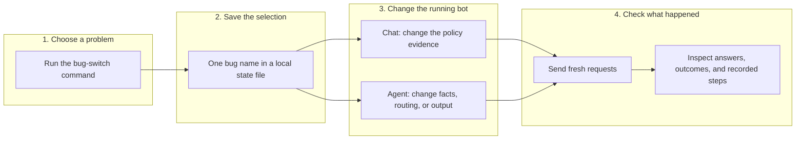
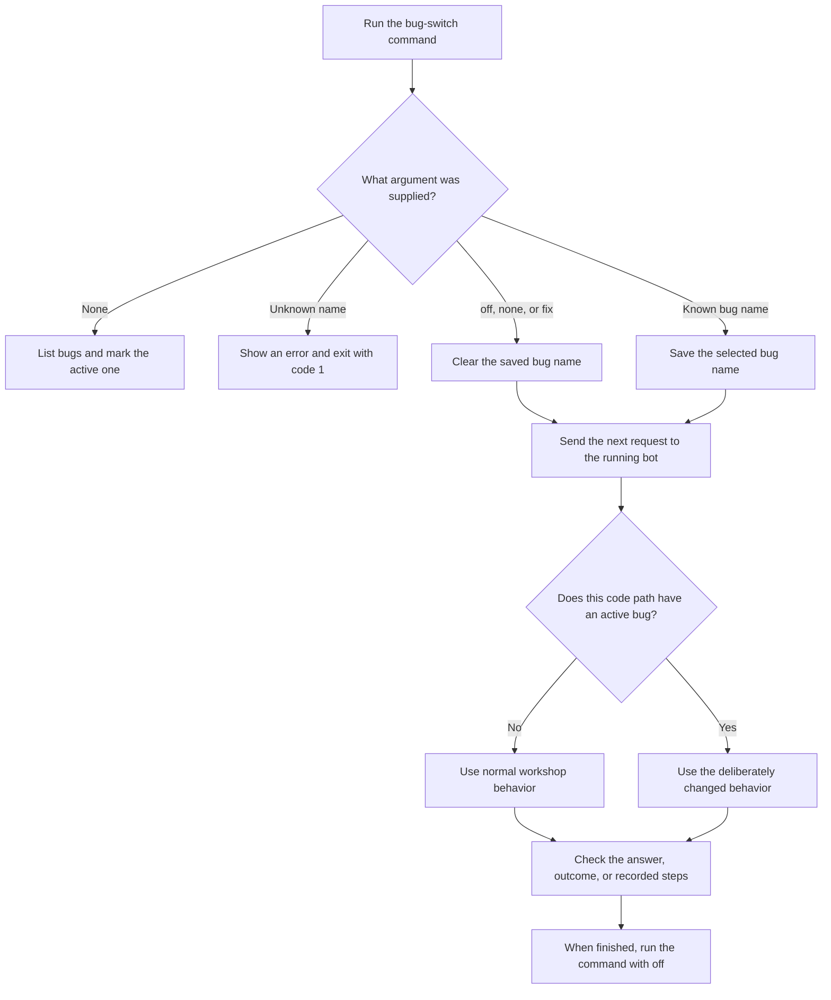

## Table of contents

- [Overview](#overview)
- [Core concepts: four pieces work together](#core-concepts-four-pieces-work-together)
- [Execution flow: what happens after the command?](#execution-flow-what-happens-after-the-command)
- [Before demonstrating a bug](#before-demonstrating-a-bug)
- [Quick map: which bug tests which idea?](#quick-map-which-bug-tests-which-idea)
- [1. `liar`: the model receives a false policy](#1-liar-the-model-receives-a-false-policy)
- [2. `no_pages`: the librarian brings nothing](#2-no_pages-the-librarian-brings-nothing)
- [3. `skip_lookup`: the recorded journey is in the wrong order](#3-skip_lookup-the-recorded-journey-is-in-the-wrong-order)
- [4. `overpay`: the execution step changes the amount](#4-overpay-the-execution-step-changes-the-amount)
- [5. `blind_reviewer`: approval without the evidence](#5-blind_reviewer-approval-without-the-evidence)
- [6. `no_breaker`: the review loop ignores its intended limit](#6-no_breaker-the-review-loop-ignores-its-intended-limit)
- [7. `shared_memory`: one customer's facts leak into another case](#7-shared_memory-one-customers-facts-leak-into-another-case)
- [8. `false_promise`: the words disagree with the outcome](#8-false_promise-the-words-disagree-with-the-outcome)
- [Key takeaway: demonstrate the evidence, not just a red test](#key-takeaway-demonstrate-the-evidence-not-just-a-red-test)

## Overview

[plant_bug.py](plant_bug.py) deliberately enables one known problem in the running Step 5 bot. You then send requests to that same bot and check whether your tests notice the problem.

This is called fault injection: introduce a controlled failure to prove that your checks are useful. These are workshop simulations; refund operations do not move real money.

## Core concepts: four pieces work together



| Piece | Open this file | What to point at |
|---|---|---|
| Command | [plant_bug.py](plant_bug.py) | The argument selects a bug, clears it, or lists the choices. |
| Switchboard | [shared/planted_bugs.py](shared/planted_bugs.py) | `BUGS`, `STATE_FILE`, `current()`, and `active()`. |
| Chat entry point | [build/step5_agent/app.py](build/step5_agent/app.py) | `chat()` calls `tamper_pages()` after retrieving policies. |
| Agent entry point | [build/step5_agent/agent.py](build/step5_agent/agent.py) | The `active("bug_name")` branches inside the crew. |
| Checks | [evaluate](evaluate/) | Step 6 checks words, Step 7 judges answers, Step 8 checks the agent's journey and outcome. |

The command writes a name into `.planted_bug` in the project root. It does not rewrite the bot's Python files or edit the policy documents.

```text
Choose one bug -> save its name -> bot reads the switch -> test observes the change
```

## Execution flow: what happens after the command?



* Only one planted bug is selected at a time. Selecting another replaces the previous selection.
* No server restart is needed. The hooks read the switch as requests run.
* The selection survives a server restart until you switch it off.
* Run the command in the same project checkout that the bot server uses. A local switch does not change a bot hosted elsewhere.
* `off` disables the planted behavior. It does not complete TODO exercises or fix unrelated problems.

## Before demonstrating a bug

1. Finish the Step 5 exercises in [agent.py](build/step5_agent/agent.py), especially the review-routing and execution-rule TODOs. Otherwise the starting bot already has unfinished behavior.
2. Keep the full Step 5 app running using `uvicorn app:app --reload` from [build/step5_agent](build/step5_agent/). The simple app and simple agent are not wired to these switches.
3. Open a separate terminal at the project root and activate the virtual environment there too.
4. Disable planted bugs and run the chosen check once before introducing the failure.
5. Enable one bug, rerun the same check, and inspect the evidence.
6. Disable the bug afterwards.

All commands below run from the project root. Test paths use Windows separators; on Mac/Linux, replace `\` with `/`.

```powershell
python plant_bug.py
python plant_bug.py off
```

Steps 6 and 7 already call the running bot. Enabling a bug changes the bot's behavior, not whether the tests use a real server.

The `EXPERIMENT` lines in the simple scripts are different: they can replace a received answer inside the test script. Disable those overrides when demonstrating a planted bot bug.

Fresh bot requests use the model API and can cost money. Responses are not cached, so separate tests can receive different answers.

## Quick map: which bug tests which idea?

| Bug | Plain-language explanation | Main code hook | Useful check |
|---|---|---|---|
| `liar` | Give the chat model a false policy page. | [tamper_pages](shared/planted_bugs.py), called by [chat](build/step5_agent/app.py) | Price-match rules and truth/correctness judging |
| `no_pages` | Take away all retrieved policy pages. | [tamper_pages](shared/planted_bugs.py), called by [chat](build/step5_agent/app.py) | Return-window rules, response context, and judge results |
| `skip_lookup` | Record the proposed action before the order lookup. | [case_investigator and _proposal_first](build/step5_agent/agent.py) | Tool ordering, not just the final outcome |
| `overpay` | Double the amount at execution time. | [execute_action](build/step5_agent/agent.py) | Amount must not exceed the price paid |
| `blind_reviewer` | Ask the reviewer to decide without the gathered facts. | [policy_reviewer](build/step5_agent/agent.py) | Reviewer input must contain the order details |
| `no_breaker` | Keep retrying rejected proposals past the intended limit. | [route_after_policy_review](build/step5_agent/agent.py) | Exactly three reviews, then escalation |
| `shared_memory` | Start a customer's case with the previous customer's facts. | [_investigate and _PREVIOUS_FACTS](build/step5_agent/agent.py) | Customer B must not receive customer A's facts |
| `false_promise` | Say a refund was issued when the outcome is no refund. | [execute_action](build/step5_agent/agent.py) | Reply must agree with the recorded outcome |

Click a code link, then use Ctrl+F to find the function or bug name shown below.

## 1. `liar`: the model receives a false policy

Teaching line: "The assistant can follow its source perfectly and still give the wrong answer if the source is wrong."

```text
Real policy pages -> add a false price-match page -> model reads it -> check the answer
```

Open [shared/planted_bugs.py](shared/planted_bugs.py) and search for `FAKE_PRICE_MATCH_PAGE`, then `tamper_pages`.

* The false page says ShopKart matches a competitor's lower price.
* It is prepended when the question contains `price`, `match`, or `cheaper`, ignoring case.
* The hook keeps up to two of the original retrieved pages after the false page.
* The real policy files are not changed.

Open [app.py](build/step5_agent/app.py) and search for `tamper_pages`. This shows exactly where the false evidence enters the chat prompt.

Open the `price-match` case in [golden_questions.yaml](evaluate/golden_questions.yaml). Its answer key says there is no price-matching policy; its forbidden phrases catch common invented promises.

```powershell
python plant_bug.py liar
python -m pytest evaluate\step6_rules\test_rules.py -v -k price
```

For the judge version:

```powershell
python -m pytest evaluate\step7_judge\test_judge.py -v -k price
```

Look for an invented promise and compare the reply with the clean answer key. A grounding metric alone can miss this bug because the false claim is supported by the injected page. The exact wording and test results can vary with the model.

## 2. `no_pages`: the librarian brings nothing

Teaching line: "Before blaming the answer, check whether the assistant received any evidence."

```text
Retrieved pages -> replace them with an empty list -> model has no policy evidence
```

Open [shared/planted_bugs.py](shared/planted_bugs.py), find `tamper_pages`, and point at the `no_pages` branch returning `[]`.

Open [app.py](build/step5_agent/app.py) to show that the prompt now says no policy pages were found. The returned `sources` and `context` lists are empty too.

```powershell
python plant_bug.py no_pages
python -m pytest evaluate\step6_rules\test_rules.py -v -k return
```

The return-window check expects `30`. A model that admits it has no policy information can fail that rule. Inspect the empty context as well: the word check alone does not prove that retrieval worked, and the model might still guess the number.

These first two switches affect `/chat`. They do not replace the policy pages returned by the agent's separate `check_policy()` tool.

## 3. `skip_lookup`: the recorded journey is in the wrong order

Teaching line: "A correct final amount does not prove the recorded process was correct."

```text
Normal record: get_order -> issue_refund proposal
Buggy record:  issue_refund proposal -> get_order
```

Open [agent.py](build/step5_agent/agent.py) and search for `case_investigator`, then `_proposal_first`.

* The investigation runs first.
* The helper moves the new round's `proposal` entries ahead of its other recorded steps.
* The returned outcome and refund amount can still be correct.

Important distinction: this implementation deliberately reorders the flight recorder after investigation. It does not actually execute a payment before looking up the order.

```powershell
python plant_bug.py skip_lookup
python -m pytest evaluate\step8_agent\test_agents.py -v -k "tool_correctness and 1043"
```

Open [test_agents.py](evaluate/step8_agent/test_agents.py), find `test_tool_correctness`, and show the expected order: `get_order` before `issue_refund`.

The manual equivalent is `test_right_tool_right_order`; that test remains skipped until its TODO is completed.

## 4. `overpay`: the execution step changes the amount

Teaching line: "Even an approved proposal needs checks on what was actually executed."

```text
Approved amount: EUR 49 -> multiply by two -> recorded refund: EUR 98
```

Open [agent.py](build/step5_agent/agent.py), find `execute_action`, and search for `active("overpay")`.

The multiplication happens only when the proposed action is `issue_refund`. It changes the amount passed to the simulated refund function and recorded in the outcome.

```powershell
python plant_bug.py overpay
python evaluate\step8_agent\agent_check_simple.py
```

Open [agent_check_simple.py](evaluate/step8_agent/agent_check_simple.py) and point at Check D, `no overpayment`. For order 1043, compare the outcome amount with the EUR 49 price paid.

The pytest equivalent is `test_right_amount` in [test_agents.py](evaluate/step8_agent/test_agents.py); complete its TODO before expecting that test to catch the bug.

## 5. `blind_reviewer`: approval without the evidence

Teaching line: "Passing a case to a reviewer is not enough. Did the reviewer receive the facts?"

```text
Order facts gathered -> replace reviewer's facts with [] -> reviewer sees only the remaining briefing
```

Open [agent.py](build/step5_agent/agent.py), find `policy_reviewer`, and point at the branch that assigns `facts = []`.

The customer message and proposed action still reach the reviewer. The gathered tool facts do not. The bug does not force approval; it makes the review blind.

```powershell
python plant_bug.py blind_reviewer
python evaluate\step8_agent\agent_check_simple.py
```

Open [agent_check_simple.py](evaluate/step8_agent/agent_check_simple.py) and point at Check B, `reviewer saw the facts`. Inspect each review step's `input`, especially whether it includes `price_paid`.

The pytest equivalent is `test_baton_passed` in [test_agents.py](evaluate/step8_agent/test_agents.py); its TODO must be completed first.

## 6. `no_breaker`: the review loop ignores its intended limit

Teaching line: "A retry needs a stopping rule, not just another attempt."

```text
Reviewer rejects -> investigate again -> reviewer rejects -> intended three-round stop is bypassed
```

Open [agent.py](build/step5_agent/agent.py), find `MAX_ROUNDS`, then `route_after_policy_review`.

The bug sends every rejected proposal back to the investigator before the normal stopping rule can run. The test also supplies `chaos="reviewer_says_no"` so that rejection is guaranteed.

```powershell
python plant_bug.py no_breaker
python -m pytest evaluate\step8_agent\test_agents.py -v -k orchestration_circuit_breaker
```

Open `test_orchestration_circuit_breaker` in [test_agents.py](evaluate/step8_agent/test_agents.py). It expects escalation after exactly three reviews.

This is not literally an infinite process: `run_agent()` has a separate LangGraph recursion limit of 25 graph steps. When that safety net stops the run, the code returns `action: "loop_limit"` with an empty step list, not the intended three-review escalation.

This demo can make many model calls. Complete the Step 5 review-routing TODO before comparing the normal and buggy behavior.

## 7. `shared_memory`: one customer's facts leak into another case

Teaching line: "A new customer needs a fresh case, not the previous customer's evidence."

```text
Customer A facts -> shared saved list -> customer B starts with A's facts -> B's reviewer sees them
```

Open [agent.py](build/step5_agent/agent.py) and search for `_PREVIOUS_FACTS`.

* At the end of an investigation, the facts are saved in this process-wide list.
* With the bug enabled, a new investigation with no facts starts by copying that list.
* Fresh facts can then be added alongside the old ones.

```powershell
python plant_bug.py shared_memory
python -m pytest evaluate\step8_agent\test_agents.py -v -k memory_customers_isolated
```

Open `test_memory_customers_isolated` in [test_agents.py](evaluate/step8_agent/test_agents.py). It sends customer A's order 1043, then customer B's order 1061, and looks for `"1043"` in B's reviewer input.

Use one server process for this demonstration. The leaked list lives in that process's memory; a server restart clears it. Switching the bug off stops reuse but does not itself erase the list.

## 8. `false_promise`: the words disagree with the outcome

Teaching line: "A friendly confirmation is not proof that the action happened."

```text
Recorded outcome: no_refund -> replace reply with a refund confirmation -> compare words with outcome
```

Open [agent.py](build/step5_agent/agent.py), find `execute_action`, and search for `active("false_promise")`.

The code changes the reply to "Good news: your refund has been issued." inside the `no_refund` branch. It does not change the recorded outcome or amount, and it does not apply to the escalation branch.

```powershell
python plant_bug.py false_promise
python -m pytest evaluate\step8_agent\test_agents.py -v -k "output_reply_matches_outcome and 1061"
```

Open `test_output_reply_matches_outcome` and `PROMISES` in [test_agents.py](evaluate/step8_agent/test_agents.py). Order 1061 is outside the return window, so a refund confirmation conflicts with its expected no-refund outcome.

## Key takeaway: demonstrate the evidence, not just a red test

Use the same four-step teaching pattern for every bug:

1. Explain what correct behavior should be.
2. Open the hook and show the one deliberate change.
3. Run the check and point at the answer, amount, reviewer input, or recorded order that exposes it.
4. Disable the bug and rerun the same check.

```powershell
python plant_bug.py off
```

A skipped test is unfinished, not a successful detection. A word check can miss a paraphrase, and an AI judge can disagree, so inspect the evidence rather than promising that every planted bug makes every test red.

Open this document's Markdown preview with Ctrl+Shift+V to see the Mermaid diagrams.
